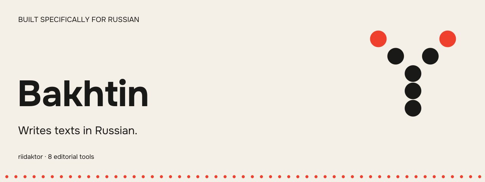
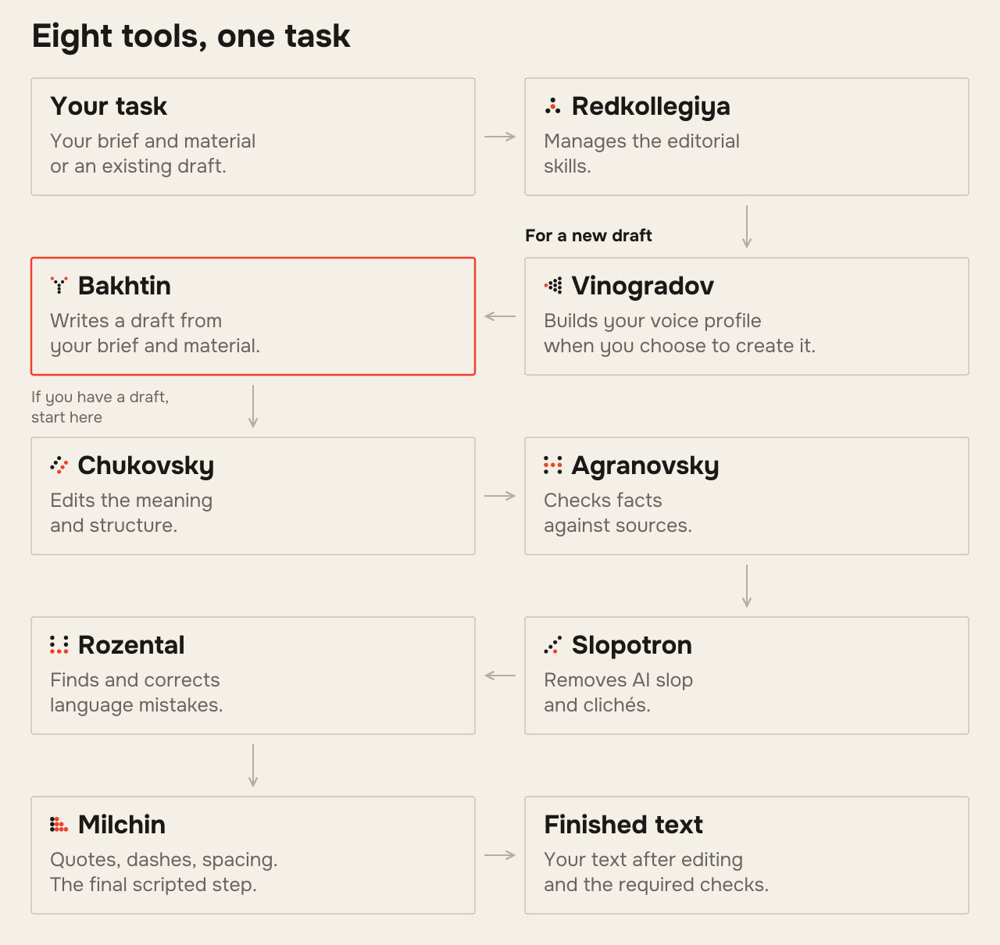

[Русский](README.md) · [English](README.en.md)

<picture>
  <source media="(prefers-color-scheme: dark)" srcset="assets/brand/cover-en-dark.svg">
  
</picture>

# Bakhtin

**Built specifically for Russian.** Writes posts, emails and articles from your brief and material in the style you need.

[How to install](#how-to-install) · [Example tasks](#example-tasks)

## How it works

Explain what you want to write, who it is for and why, and attach your material. Bakhtin asks about anything missing, works out how to develop the idea and writes in the style you need. You get a draft to review and refine.


## Example tasks

### Write a post from notes

> Use Bakhtin to write a post from my notes for first-time managers. Ask about missing material first. Do not invent facts or personal experience.

### Draft an email

> Write an email to a client from this brief. Explain the schedule change, what we have done and what decision we need from them. Keep the tone calm and direct.

### Explain a difficult subject

> Draft an article from these materials for a non-specialist reader. Develop one idea at a time, use examples from the sources and flag gaps.


## How to install

### For agents

Claude Code, Codex / ChatGPT Desktop, Cursor, GitHub Copilot, Gemini CLI — give your agent this instruction:

```text
Install the Bakhtin skill:
https://github.com/beaverbeard/bakhtin

Use it whenever we write or edit texts.
```

<details>
<summary>More options</summary>

Agent-specific setup: [Claude Code](docs/OTHER-APPS.en.md#claude-code), [ChatGPT Desktop / Codex](docs/OTHER-APPS.en.md#codex), [Cursor](docs/OTHER-APPS.en.md#cursor), [GitHub Copilot](docs/OTHER-APPS.en.md#copilot), [Gemini CLI](docs/OTHER-APPS.en.md#gemini-cli).

### ChatGPT, Claude or Gemini in a browser

Download [this skill’s package](docs/downloads/bakhtin.zip). It includes the instructions, scripts and resources.

- **ChatGPT:** create a project and add the instructions and resources from the extracted package. [Step by step](docs/OTHER-APPS.en.md#chatgpt).
- **Claude:** enable code execution and upload the ZIP in Customize → Skills. [Step by step](docs/OTHER-APPS.en.md#claude).
- **Gemini:** open Customize → Skills → Create → Upload and upload the package. [Step by step](docs/OTHER-APPS.en.md#gemini).

Available stages depend on the tools in your app. [Check readiness](docs/OTHER-APPS.en.md#readiness).

### Better still: the whole Redkollegiya toolkit

Install [Redkollegiya](https://github.com/beaverbeard/redkollegiya) with all eight skills. It selects the tools for writing, editing and proofreading. Give your agent this instruction:

```text
Install Redkollegiya and the complete set of eight editorial skills:
https://github.com/beaverbeard/redkollegiya

Use them whenever we write or edit texts.
```

</details>


## When your input is needed

Bakhtin asks when the purpose, reader or source facts are unclear. Review the draft before publication; use [Redkollegiya](https://github.com/beaverbeard/redkollegiya) for the complete editing workflow.

## Inside the toolkit

Bakhtin handles one part of the writing workflow. Start with [Redkollegiya](https://github.com/beaverbeard/redkollegiya) for the complete process; it selects the tools for the task.

<picture>
  <source media="(prefers-color-scheme: dark) and (max-width: 600px)" srcset="assets/brand/system-map-en-dark-narrow.svg">
  <source media="(prefers-color-scheme: dark)" srcset="assets/brand/system-map-en-dark.svg">
  <source media="(max-width: 600px)" srcset="assets/brand/system-map-en-light-narrow.svg">
  
</picture>

These eight skills make up the writing toolkit. Below are their responsibilities and links to their repositories.

| Skill | What it helps you do |
|---|---|
| [Редколлегия / Redkollegiya](https://github.com/beaverbeard/redkollegiya) | Writes and edits texts, from the first draft through fact-checking and final proofreading. |
| [Виноградов / Vinogradov](https://github.com/beaverbeard/vinogradov) | Helps AI write in your style by analysing your texts and building an author voice profile. |
| [Бахтин / Bakhtin](https://github.com/beaverbeard/bakhtin) | Writes posts, emails and articles from your brief and material in the style you need. |
| [Чуковский / Chukovsky](https://github.com/beaverbeard/chukovsky) | Edits texts by improving structure, fixing gaps in logic and removing bureaucratic wording. |
| [Аграновский / Agranovsky](https://github.com/beaverbeard/agranovsky) | A fact-checking skill for texts. Checks numbers, dates, quotes and links, and shows sources. |
| [Слопотрон / Slopotron](https://github.com/beaverbeard/slopotron) | Clears out the AI slop and clichés everyone is sick of. |
| [Розенталь / Rozental](https://github.com/beaverbeard/rozental) | A proofreading skill: checks and corrects texts. Finds mistakes in spelling, punctuation and grammar. |
| [Мильчин / Milchin](https://github.com/beaverbeard/milchin) | A typography skill: formats text to Russian typesetting rules. Checks quotes, dashes and spacing. |

## The riidaktor newsletter

In riidaktor, we explore how to write and edit texts with AI.

Learn to give clearer briefs, retain your own voice and spot invented details. Take the techniques into your workflow to spend less time reworking drafts and publish with more confidence.

[Subscribe to the newsletter →](https://redaktozavr.ru/rAIdactor?utm_source=skills)


## Compatibility and source

Check the tools available in your app when setting up. The English page translates the documentation.

[SKILL.md](https://github.com/beaverbeard/bakhtin/blob/f966bd1ff0e632755141d989a30ff0dc9d662474/.claude/skills/bakhtin/SKILL.md) · [MIT](https://github.com/beaverbeard/bakhtin/blob/f966bd1ff0e632755141d989a30ff0dc9d662474/LICENSE)
